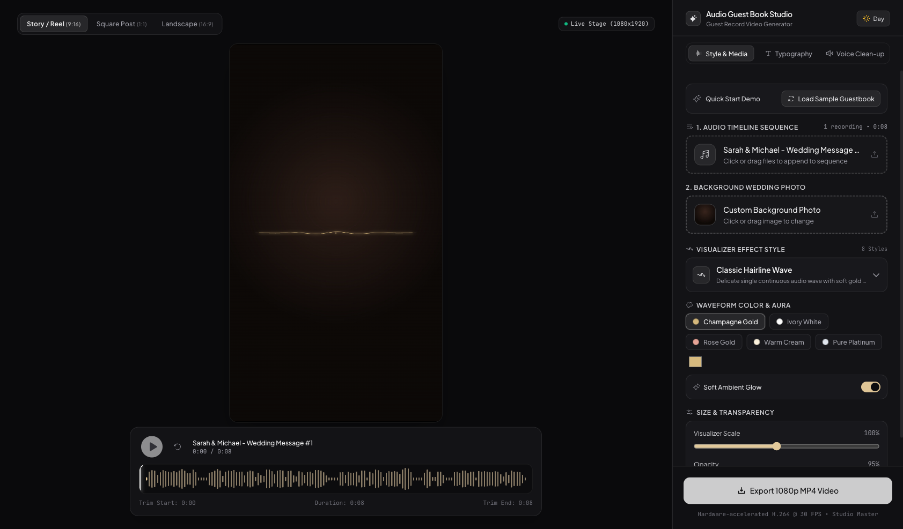
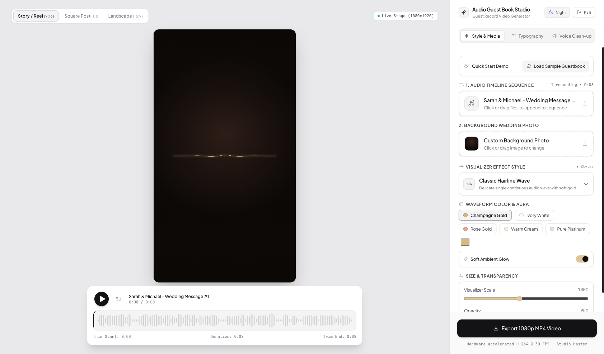
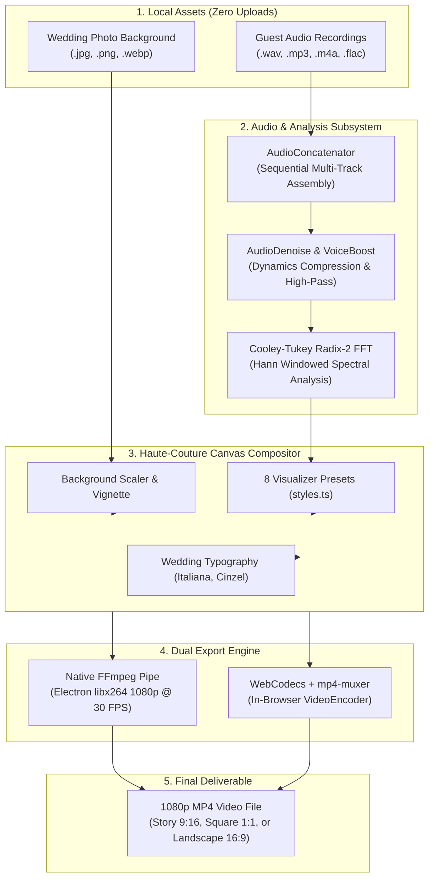

# Audio Guest Book Studio 💍🎙️

> **An elegant, private, open-source desktop application that turns vintage audio guestbook voicemails and wedding recordings into cinematic 1080p MP4 videos with centered real-time audio visualizers, background photos, and haute-couture typography.**
>
> *Created & maintained by **Edgars Kalniņš**, founder of **[Momentbox.lv](https://momentbox.lv)** — premium photo booth, 360 video spinner, and vintage audio guestbook rental service based in Riga, Latvia.*

[](LICENSE)
[](#-privacy--zero-telemetry-pledge)
[](#-platform-support)
[](https://react.dev)
[](https://www.typescriptlang.org)
[](https://vitejs.dev)

---

## 🤖 Ask an AI Agent to Run This Project

Working with an AI coding agent (**Claude Code**, **Cursor**, **Codex**, **Windsurf**, **Antigravity**, **OpenCode**, or **Gemini CLI**)? You can hand this repository directly to your agent to run, test, and develop.

### Copy & Paste Prompt for Your Agent:

```markdown
Clone https://github.com/your-username/audio-guest-book-studio.git, install dependencies using `npm install`, verify the test suite with `npm test`, compile the TypeScript bundle via `npm run build`, and launch the development studio with `npm run dev`.
```

### Agent Quick-Start Instructions:

```bash
# 1. Clone repository from GitHub
git clone https://github.com/your-username/audio-guest-book-studio.git
cd audio-guest-book-studio

# 2. Install dependencies
npm install

# 3. Run automated test suite (18 unit & integration tests)
npm test

# 4. Compile production bundles
npm run build

# 5. Launch development server & Electron studio
npm run dev
```

### Key Technical Context for Agents:
- **Stack**: React 19, TypeScript 5.6, Vite 6, Tailwind CSS v3 (`darkMode: 'class'`), `@phosphor-icons/react`.
- **Desktop Runtime**: Electron 33 with secure Context Isolation (`electron/main.ts`, `electron/preload.ts`).
- **Core Engine Modules**:
  - Web Audio player & dynamic range compressor: [`src/engine/audioEngine.ts`](file:///Users/edgarskalnins/Desktop/Wedding%20Audio%20Studio/src/engine/audioEngine.ts)
  - Multi-track timeline sequencing: [`src/engine/audioConcatenator.ts`](file:///Users/edgarskalnins/Desktop/Wedding%20Audio%20Studio/src/engine/audioConcatenator.ts)
  - In-memory Cooley-Tukey Radix-2 FFT: [`src/engine/fft.ts`](file:///Users/edgarskalnins/Desktop/Wedding%20Audio%20Studio/src/engine/fft.ts)
  - Frame rendering orchestrator: [`src/engine/frameGenerator.ts`](file:///Users/edgarskalnins/Desktop/Wedding%20Audio%20Studio/src/engine/frameGenerator.ts)
  - Bundled FFmpeg pipe: [`src/engine/videoExporter.ts`](file:///Users/edgarskalnins/Desktop/Wedding%20Audio%20Studio/src/engine/videoExporter.ts)
  - 8 Visualizer algorithms: [`src/engine/visualizers/styles.ts`](file:///Users/edgarskalnins/Desktop/Wedding%20Audio%20Studio/src/engine/visualizers/styles.ts)
- **Local Dev Server**: Vite runs on `http://localhost:5173/`. Can be tested in any browser or headless automation tool (`ego-browser`, Playwright, Puppeteer).
- **Strict Privacy Requirement**: Zero telemetry, zero analytics, zero external network pings. All processing runs 100% locally.

---

## 📸 Screenshots

| Dark Mode (Default) | Light Mode (Day Theme) |
| :---: | :---: |
|  |  |

---

## 🔒 Privacy & Zero-Telemetry Pledge

Wedding and event voicemails are deeply intimate family moments: heartfelt grandparent blessings, tearful parental toasts, and hilarious late-night messages from closest friends.

**Audio Guest Book Studio is built on an absolute local-first architecture:**
- **Zero Cloud Uploads**: Audio, photos, and video compilation never leave your computer.
- **Zero Telemetry & Analytics**: No Google Analytics, no Mixpanel, no Sentry, no phone-home pingbacks, and no user tracking.
- **100% Offline Capability**: Runs entirely without an active internet connection. All font families, icons, and encoder binaries are packaged locally.
- **Open Source Transparency**: Every line of code is open to inspection and audit.

---

## ✨ Key Capabilities

1. **Continuous Multi-Recording Timeline**:
   - Drag and drop 1 or 50 audio recordings (`.wav`, `.mp3`, `.m4a`, `.aac`, `.flac`, `.ogg`, `.aiff`).
   - Automatically sequences all files into **one continuous, seamless video timeline** with configurable micro-gaps (0.5s), avoiding manual stitching in external video editors.
2. **8 Bespoke Hairline & Organic Visualizers**:
   - **Classic Hairline Wave**: Delicate single continuous audio wave with soft gold luminescence.
   - **Mirrored Hairline Wave**: Elegant symmetrical twin waves reflecting romantic voice vibrations.
   - **Horizon Pulse Line**: Crisp center-weighted audio line reacting to voice intimacy.
   - **Voice Memo Bars**: Centered symmetrical rounded frequency bars.
   - **Sine Ribbon**: Dual-phase flowing organic sound waves.
   - **Orbital Ring**: Radial halo visualizer with circular frequency dispersion.
   - **Dual Mirror Wave**: Symmetrical frequency bars radiating vertically.
   - **Particulate Aura**: Ambient floating stardust dancing to guest speech frequencies.
3. **Haute-Couture Wedding Typography**:
   - Five curated editorial font families: *Italiana*, *Cinzel*, *Cormorant Garamond*, *Playfair Display*, and *Plus Jakarta Sans*.
   - Customizable Couple Names, Wedding Date, and Subtitle (`Wedding Audio Guestbook`).
   - Optional digital timestamp counter (`0:42 / 2:15`) with subtle progress hairline.
4. **Day / Night Theme Switching**:
   - Seamless one-click toggle between Deep Charcoal/Obsidian Dark Mode and Crisp Alabaster Light Mode, persisted locally.
5. **Acoustic Voice Clean-Up & Trimmer**:
   - **Voice Boost (Auto-Gain)**: Dynamic range compression and high-pass filtering to elevate quiet guest whispers.
   - **Waveform Trimmer**: Non-destructive start/end trimming to remove telephone pickup clicks and receiver hangup noises.
6. **Dual High-Speed Compilation Pipeline**:
   - **Native Hardware FFmpeg**: Bundled local FFmpeg pipe (`libx264` @ 30 FPS, AAC 192 kbps) with automated directory creation and stream buffering.
   - **Client-Side WebCodecs Fallback**: Modern in-browser `VideoEncoder` + `AudioEncoder` piped to `mp4-muxer` for browser previews.
   - **Resource Offloading**: Preview rendering suspends during export to dedicate 100% CPU/GPU resources to video encoding.

---

## 🏛️ System Architecture



---

## 📂 Source Code & Component Directory

Every module in this project is strictly decoupled, strongly typed, and thoroughly tested:

### 🖥️ User Interface (`src/components/`)
- [`src/App.tsx`](file:///Users/edgarskalnins/Desktop/Wedding%20Audio%20Studio/src/App.tsx): Root layout orchestrator, multi-track sequence state, Day/Night theme synchronization, and titlebar window controls.
- [`src/components/CanvasStage.tsx`](file:///Users/edgarskalnins/Desktop/Wedding%20Audio%20Studio/src/components/CanvasStage.tsx): Real-time 60 FPS HTML5 canvas viewport, aspect ratio selector (`9:16`, `1:1`, `16:9`), drag-and-drop overlay, and interactive audio scrubber.
- [`src/components/MediaDropzone.tsx`](file:///Users/edgarskalnins/Desktop/Wedding%20Audio%20Studio/src/components/MediaDropzone.tsx): Drag-and-drop dropzone for audio files and photo backgrounds with quick-start sample loading.
- [`src/components/VisualizerPanel.tsx`](file:///Users/edgarskalnins/Desktop/Wedding%20Audio%20Studio/src/components/VisualizerPanel.tsx): Visualizer preset selector featuring custom hairline vector glyphs for all 8 visualizer modes, color swatches, glow, and scale sliders.
- [`src/components/TypographyPanel.tsx`](file:///Users/edgarskalnins/Desktop/Wedding%20Audio%20Studio/src/components/TypographyPanel.tsx): Wedding typography overlay configuration supporting couple names, wedding date, title, and 5 curated editorial font families.
- [`src/components/AudioToolsPanel.tsx`](file:///Users/edgarskalnins/Desktop/Wedding%20Audio%20Studio/src/components/AudioToolsPanel.tsx): Voice Boost auto-gain normalization switch and telephone pickup/hangup trim sliders.
- [`src/components/ExportModal.tsx`](file:///Users/edgarskalnins/Desktop/Wedding%20Audio%20Studio/src/components/ExportModal.tsx): 1080p MP4 compilation progress dialog with frame counter, background resource suspension notices, and "Show in Finder / Explorer" action.
- [`src/components/ExitModal.tsx`](file:///Users/edgarskalnins/Desktop/Wedding%20Audio%20Studio/src/components/ExitModal.tsx): Safe session termination modal preventing accidental data loss when timeline recordings or exports are in flight.

### ⚙️ Audio & Rendering Engine (`src/engine/`)
- [`src/engine/audioEngine.ts`](file:///Users/edgarskalnins/Desktop/Wedding%20Audio%20Studio/src/engine/audioEngine.ts): Web Audio API wrapper managing playback state, AnalyserNode frequency extraction, and waveform peak generation.
- [`src/engine/audioConcatenator.ts`](file:///Users/edgarskalnins/Desktop/Wedding%20Audio%20Studio/src/engine/audioConcatenator.ts): Non-destructive multi-recording concatenation combining multiple audio buffers into one continuous stream with smooth inter-track micro-gaps.
- [`src/engine/audioDenoise.ts`](file:///Users/edgarskalnins/Desktop/Wedding%20Audio%20Studio/src/engine/audioDenoise.ts): Voice Boost auto-gain DSP filter normalizing whisper volumes and reducing low-frequency microphone rumble.
- [`src/engine/fft.ts`](file:///Users/edgarskalnins/Desktop/Wedding%20Audio%20Studio/src/engine/fft.ts): In-memory Cooley-Tukey Radix-2 Fast Fourier Transform with Hann windowing for offline frame-by-frame video generation.
- [`src/engine/frameGenerator.ts`](file:///Users/edgarskalnins/Desktop/Wedding%20Audio%20Studio/src/engine/frameGenerator.ts): Memory-optimized video pipeline orchestrating off-screen canvas rendering, memory garbage collection, and dual encoder selection.
- [`src/engine/videoExporter.ts`](file:///Users/edgarskalnins/Desktop/Wedding%20Audio%20Studio/src/engine/videoExporter.ts): Native Electron FFmpeg pipe with auto-directory creation and stream buffering.
- [`src/engine/visualizers/renderer.ts`](file:///Users/edgarskalnins/Desktop/Wedding%20Audio%20Studio/src/engine/visualizers/renderer.ts): Master canvas frame compositor combining background image cover-scaling, soft ambient vignette, audio visualizer, and typography text layers.
- [`src/engine/visualizers/styles.ts`](file:///Users/edgarskalnins/Desktop/Wedding%20Audio%20Studio/src/engine/visualizers/styles.ts): Mathematical drawing algorithms for all 8 visualizer modes.

### 🔌 Desktop Shell (`electron/`)
- [`electron/main.ts`](file:///Users/edgarskalnins/Desktop/Wedding%20Audio%20Studio/electron/main.ts): Secure Electron main process providing native file dialogues, safe window close interception, asset resolution, and FFmpeg transcoding fallbacks.
- [`electron/preload.ts`](file:///Users/edgarskalnins/Desktop/Wedding%20Audio%20Studio/electron/preload.ts): Context-isolated IPC bridge exposing strictly typed `window.electronAPI` methods to the frontend.

---

## 💻 Platform Support

Audio Guest Book Studio is engineered to compile and run smoothly across all major desktop operating systems without platform lock-in:

| Platform | Target Binaries | Architecture | Acceleration |
| :--- | :--- | :--- | :--- |
| **macOS** | `.dmg`, `.zip`, `.app` | Apple Silicon (`arm64`) & Intel (`x64`) | VideoToolbox / H.264 |
| **Windows** | `.exe` (NSIS Installer), Portable | `x64` | NVENC / D3D11VA / H.264 |
| **Linux** | `.AppImage`, `.deb`, `.tar.gz` | `x64`, `arm64` | VAAPI / H.264 |

---

## 🚀 Getting Started

### Prerequisites
- [Node.js](https://nodejs.org) (v18 or higher recommended)
- `npm` (v9 or higher)

### 1. Clone & Install
```bash
git clone https://github.com/your-username/audio-guest-book-studio.git
cd audio-guest-book-studio
npm install
```

### 2. Run in Development Mode
```bash
npm run dev
```
This boots Vite with hot-module replacement and launches the Electron studio window automatically.

### 3. Run Automated Tests
```bash
npm test
```
Runs the full Vitest suite covering audio concatenation, FFT spectrum generation, FFmpeg export pipelines, and modal interactions.

### 4. Build Production Binaries
```bash
# Type check and build frontend + electron scripts
npm run build

# Package desktop installer for current OS
npm run build:app
```
Packaged installers will be saved in the `release/` directory.

---

## ⌨️ Keyboard Shortcuts

| Shortcut | Action |
| :--- | :--- |
| `Space` | Play / Pause audio playback |
| `Esc` | Dismiss modal / Close active dialog |
| `Cmd + Q` / `Ctrl + Q` | Trigger safe Exit confirmation |

---

## 🤝 Contributing

Contributions from the open-source community are warmly welcomed! Please read our [CONTRIBUTING.md](CONTRIBUTING.md) guide before submitting pull requests.

**Core Rules for Contributors**:
- **Zero Telemetry Policy**: No PR adding external telemetry, tracking, or network telemetry will be accepted.
- **Offline Reliability**: Every new feature must function completely offline.
- **Test Coverage**: All new audio or export pipeline features must include corresponding Vitest tests in `tests/`.

---

## 👨‍💻 Author & Origin Story

**Audio Guest Book Studio** was designed, developed, and open-sourced by **Edgars Kalniņš**, founder of **[Momentbox.lv](https://momentbox.lv)** — Latvia’s leading event entertainment and experiential rental company based in **Riga, Latvia (Rīga, Latvija)**.

### Why this project was created:
At **[Momentbox.lv](https://momentbox.lv)**, we provide vintage audio guestbook telephone rentals, modern photo booths (fotokastes noma), and 360 video spinner platforms for weddings, anniversaries, corporate galas, and celebrations across Latvia and the Baltics. 

Couples and event hosts often receive dozens of raw audio voicemails (`.wav`, `.mp3`) from retro rotary phone guestbooks, but had no simple, private way to turn those audio memories into beautiful, shareable vertical videos (9:16 Instagram Reels, TikToks, YouTube Shorts, and Stories) without recurring cloud subscription fees or uploading personal, emotional guest messages to third-party cloud servers.

**Audio Guest Book Studio** was built to solve this exact challenge: a high-performance, 100% offline, zero-telemetry desktop application that operates entirely on the user's computer, empowering couples, wedding videographers, event rental companies, and photo booth operators worldwide to create studio-quality video keepsakes in seconds.

- 🌐 **Company Website**: [https://momentbox.lv](https://momentbox.lv)
- 📍 **Headquarters**: Riga, Latvia (Rīga, Latvija)
- 💌 **Specialties**: Photo booth rental (fotokaste), 360 video booth (360 video būda), and vintage telephone audio guestbooks (audio viesu grāmata) for unforgettable events.

---

## 📜 License

Distributed under the permissive **MIT License**. See [LICENSE](LICENSE) for more details.

Built with passion for couples celebrating their love and audio guestbook creators worldwide. 💍🎙️✨
