# 🗺️ Product Roadmap & Future Plans

> **Audio Guest Book Studio** is an open-source, local-first desktop application designed by **Edgars Kalniņš** ([Momentbox.lv](https://momentbox.lv)) to turn vintage audio guestbook voicemails and wedding recordings into high-definition, cinema-grade MP4 videos.

This document outlines the **10 approved roadmap features** scheduled for implementation. Every feature adheres to the project's strict **100% Offline & Zero-Telemetry Pledge**: all processing, audio DSP, video encoding, and AI models execute strictly locally on the user's computer with zero cloud dependence.

---

## 🧭 Roadmap Overview Matrix

| # | Feature | Target User | Complexity | Core Technology | Status |
| :-: | :--- | :--- | :---: | :--- | :---: |
| **01** | **Batch Export Mode (SD Card Processor)** | Rental Booths & Photographers | Medium | Electron IPC / FFmpeg Queue | 📋 Planned |
| **02** | **Social Safe-Zone Overlays & Aspect Ratios** | Couples & Social Creators | Low | HTML5 Canvas / CSS Safe Margins | 📋 Planned |
| **03** | **Audio Noise Cleanup & Speech Clarifier** | All Users (Vintage Telephones) | Medium | Web Audio DSP / Biquad Filters | 📋 Planned |
| **04** | **Transparent Alpha Video Export (WebM/ProRes)** | Wedding Videographers & Editors | Medium | FFmpeg `yuva420p` & ProRes 4444 | 📋 Planned |
| **05** | **Silence Trimmer & Outgoing Greeting Prepend** | Rental Operators & Couples | Medium | Audio Buffer Scanning & Sequencing | 📋 Planned |
| **06** | **Polaroid & Retro Photo Collage Templates** | Vintage Weddings & Events | Medium | Canvas Compositor / Frame Presets | 📋 Planned |
| **07** | **Looping Video & Animated B-Roll Backgrounds** | Creators & Reels Marketers | High | HTML5 Video Canvas / FFmpeg Multi-Input | 📋 Planned |
| **08** | **Local AI Speech-to-Text Subtitles (Whisper)** | Couples & Social Media Viewers | High | Whisper.cpp WASM / WebGPU (Local) | 📋 Planned |
| **09** | **Fine-Grained Waveform Styling & Gradients** | Designers & Event Stylists | Low | Canvas Gradients / Particle Physics | 📋 Planned |
| **10** | **Dynamic QR Code Gallery Watermark** | Rental Businesses & Event Hosts | Low | Offline SVG/Canvas QR Generator | 📋 Planned |

---

## 📌 Detailed Feature Specifications

### 1. Batch Export Mode (SD Card One-Click Processor)
* **User Story**: As an event rental operator (e.g. [Momentbox.lv](https://momentbox.lv)) or wedding photographer, I want to drop an entire SD card folder containing 50–100 individual guest recordings (`.wav`) and automatically render separate individual 1080p MP4 clips for each voicemail in one queue, so I can send individual clips to guests or couples without manual processing.
* **Architecture & Modules**:
  - `src/engine/batchExporter.ts`: Multi-file FIFO queue manager with concurrency control (sequential 1-by-1 to prevent system memory overload).
  - `src/components/ExportModal.tsx`: Adds a "Batch Mode" tab showing overall progress (`Exporting 14 of 65 files`), time elapsed, and estimated time remaining.
  - Output naming template: `[OriginalName]_visualizer.mp4` or `[CoupleNames]_[Index].mp4`.
  - Auto-skips unreadable or corrupted audio files with clear error reporting without terminating the entire batch.
* **Acceptance Criteria**:
  - Successfully processes 50+ audio files sequentially without memory leaks.
  - Emits native OS completion notification when batch completes.
  - Unit tests covering queue recovery and filename sanitization.

---

### 2. Aspect Ratio Presets with Social Safe-Zone Overlays
* **User Story**: As a bride or social media manager sharing wedding voicemails on Instagram Reels, TikTok, or YouTube Shorts, I want visual safe-zone guides so that waveforms and couple names are never covered by like/comment buttons or screen headers.
* **Architecture & Modules**:
  - Presets:
    - `9:16` Vertical Story / Reels / Shorts (`1080x1920`)
    - `16:9` Cinematic Landscape (`1920x1080`)
    - `1:1` Classic Square Feed (`1080x1080`)
    - `4:5` Portrait Social Feed (`1080x1350`)
  - `src/components/CanvasStage.tsx`: Toggleable translucent overlay depicting Instagram and TikTok native UI chrome (right-hand action bar, top profile info, bottom caption zone).
  - Dynamic visualizer repositioning: ensures all elements automatically stay inside the safe boundaries.
* **Acceptance Criteria**:
  - Safe-zone guides display cleanly in both Dark and Light themes.
  - Safe-zone overlay is strictly preview-only and never rendered into the exported MP4 video.

---

### 3. Audio Noise Cleanup & Speech Clarifier (Voice Isolation)
* **User Story**: As a user with vintage rotary phone recordings, I want to remove carbon-mic hiss, line hum, and room noise so quiet whispers and heartfelt messages sound crisp and professional.
* **Architecture & Modules**:
  - `src/engine/audioDenoise.ts`: Multi-stage local digital signal processing (DSP):
    1. **High-Pass Filter** (80Hz, 24dB/octave) to eliminate handling rumble and 50Hz/60Hz AC electrical hum.
    2. **Spectral Notch Filter** to remove vintage phone carrier frequencies (e.g. 1kHz / 3kHz line buzz).
    3. **Dynamic Noise Gate** with adjustable threshold: mutes dead space between spoken words to silence background wedding hall chatter.
    4. **Speech Clarity EQ**: Mild +2.5kHz presence boost for vocal warmth and intelligibility.
  - `src/components/AudioToolsPanel.tsx`: Sliders for "Noise Gate Threshold" and "Speech Clarity Boost" with live A/B bypass preview.
* **Acceptance Criteria**:
  - Clean audio processing without robotic artifacts or phase issues.
  - 100% offline, pure Web Audio API & offline audio buffer manipulation.

---

### 4. Transparent Alpha Video Export (WebM / Apple ProRes 4444)
* **User Story**: As a professional wedding videographer or film editor, I want to export the audio visualizer and typography on a completely transparent background so I can drag and drop it directly onto 4K drone shots or wedding films in DaVinci Resolve, Final Cut Pro, or Adobe Premiere without green-screening.
* **Architecture & Modules**:
  - Background mode option: `Transparent (Alpha Channel)`.
  - Electron FFmpeg pipeline:
    - **Apple ProRes 4444**: `-c:v prores_ks -profile:v 4 -pix_fmt yuva444p10le -c:a aac` (Industry standard for NLEs).
    - **WebM Transparent**: `-c:v libvpx-vp9 -pix_fmt yuva420p` (Web and lightweight NLE playback).
  - Canvas rendering pipeline: skips background photo drawing and clears canvas to `rgba(0, 0, 0, 0)`.
* **Acceptance Criteria**:
  - Exported video imports with genuine alpha transparency in Premiere Pro, DaVinci Resolve, and Final Cut Pro.
  - Retains delicate hairline glow and anti-aliasing against dark or bright video layers underneath.

---

### 5. Smart Silence Trimmer & Outgoing Voicemail Greeting Prepend
* **User Story**: As a couple or rental operator, I want to automatically trim dead air before/after messages, and automatically prepend our custom outgoing voicemail greeting ("Hi, leave a message after the tone!") before each recording.
* **Architecture & Modules**:
  - **Smart Silence Trimmer**: In-memory scan of the `AudioBuffer` evaluating RMS levels (`< -45dB` for consecutive blocks > 350ms) to detect exact speech start and end points.
  - **Outgoing Greeting Slot**: Secondary audio file dropzone in `src/components/MediaDropzone.tsx` for the couple's prompt message.
  - Seamless concatenator prepends the greeting and an authentic vintage telephone "BEEP" tone before the guest message begins.
* **Acceptance Criteria**:
  - Auto-trim accurately removes pickup clicks without clipping the first syllable spoken.
  - Prepend greeting plays seamlessly with zero gap or audio stutter.

---

### 6. Polaroid & Retro Photo Collage Templates
* **User Story**: As a couple planning a vintage or rustic wedding, I want our photo to look like a physical Polaroid snapshot with handwritten script notes or a 3-shot photo booth strip next to the waveform.
* **Architecture & Modules**:
  - `src/engine/visualizers/frames.ts`: Modular canvas frame compositors:
    - **Haute Couture**: Current borderless, full-bleed cinematic frame with soft ambient vignette.
    - **Vintage Polaroid**: Classic white paper border with slight 2-degree tilt, realistic drop shadow, and couple names rendered in authentic handwritten cursive on the lower border.
    - **Photo Booth Strip**: Vertical 3-frame photo strip layout alongside the audio visualizer.
    - **Vinyl Record Sleeve**: Rotating vinyl disc peeking out from an album cover with circular audio vibrations.
* **Acceptance Criteria**:
  - Frame layout scales responsively across all aspect ratios (`9:16`, `1:1`, `16:9`).
  - High-resolution paper textures rendered procedurally via Canvas without external image dependencies.

---

### 7. Looping Video & Animated B-Roll Backgrounds
* **User Story**: As a creator, I want subtle motion in the background (flickering romantic candlelight, soft bokeh lights, or a 5-second slow-motion wedding dance loop) instead of a static image.
* **Architecture & Modules**:
  - Background media selector accepts `.mp4`, `.mov`, and `.webm` files in addition to images.
  - `src/engine/frameGenerator.ts`: Video frame extraction synchronizer: extracts time-synchronized video frames from background video element during export.
  - Bundled procedural motion shaders: includes built-in offline CSS/Canvas shaders for subtle animated bokeh particles and vintage 8mm film grain dust.
* **Acceptance Criteria**:
  - Loops seamlessly throughout the duration of the audio recording.
  - FFmpeg pipeline pipes composite video frames without frame drops or audio desynchronization.

---

### 8. Local AI Speech-to-Text Subtitles (Karaoke-Style via Whisper)
* **User Story**: As a viewer watching on social media without headphones, I want to read animated, synchronized subtitles highlighting word-by-word as the guest speaks.
* **Architecture & Modules**:
  - 100% offline, private transcription using Whisper.cpp (`@remotion/install-whisper-cpp` or lightweight ONNX Whisper Tiny/Base running locally via WebGPU/WASM).
  - Zero cloud calls: audio data never leaves the device, upholding the Zero-Telemetry pledge.
  - Output: Word-level timestamps (`start`, `end`, `word`).
  - Subtitle Canvas Renderer: Renders elegant, customizable subtitles with dynamic word highlight (active spoken word illuminates in gold/white).
  - Quick-edit UI: Allows the user to click and edit any word before final export.
* **Acceptance Criteria**:
  - Operates completely offline without requiring API keys or subscriptions.
  - Word timing synchronizes tightly with audio waveform peaks.

---

### 9. Fine-Grained Waveform Styling & Gradients
* **User Story**: As a designer, I want to customize the visualizer with multi-color gradient fills (rose gold, champagne, emerald), custom bar thickness, and floating stardust particles matching our event color palette.
* **Architecture & Modules**:
  - `src/components/VisualizerPanel.tsx`:
    - Linear & radial gradient picker with preset wedding palettes (Rose Gold, Champagne Silk, Tuscan Sunset, Velvet Emerald, Minimalist Silver).
    - Stroke thickness slider (`0.5px` to `12px`).
    - Cap style selector: Round, Square, or Butt caps.
    - Floating particle density & physics velocity sliders.
* **Acceptance Criteria**:
  - Gradient angles and color transitions render cleanly on 60 FPS preview and 1080p export canvas.
  - Presets persist in `localStorage`.

---

### 10. Dynamic QR Code Gallery Watermark
* **User Story**: As an event rental operator or couple, I want a discreet QR code in the corner linking directly to the couple's online audio gallery or rental booking page (e.g. [Momentbox.lv](https://momentbox.lv)), allowing friends and family to scan and listen to all messages.
* **Architecture & Modules**:
  - Integrated zero-telemetry offline QR code generator (`qrcode` npm library).
  - Customization options:
    - Target URL input field.
    - Position selector: Top-Right, Bottom-Right, Bottom-Left.
    - Aesthetic styling: Rounded dot matrix, subtle transparency, optional "Scan to listen" micro-typography.
* **Acceptance Criteria**:
  - QR codes are sharp, scannable by iOS Camera and Android Lens at standard viewing distances.
  - Generated locally via vector math with zero internet access.

---

## 🛠️ Prioritization & Implementation Phasing

```mermaid
flowchart LR
    subgraph Phase1["Phase 1: Workflow & Social Polish (Short Term)"]
        F02["#02: Safe-Zone Overlays & Aspect Ratios"]
        F09["#09: Waveform Gradients & Styling"]
        F10["#10: Dynamic QR Code Watermark"]
    end

    subgraph Phase2["Phase 2: Power-User & Studio Pipelines (Mid Term)"]
        F01["#01: Batch SD Card Exporter"]
        F03["#03: Audio Noise Cleanup & DSP"]
        F04["#04: Transparent ProRes/WebM Export"]
        F05["#05: Silence Trimmer & Greeting Prepend"]
    end

    subgraph Phase3["Phase 3: Creative & AI Evolution (Long Term)"]
        F06["#06: Polaroid & Vintage Frame Templates"]
        F07["#07: Looping Video & B-Roll Backgrounds"]
        F08["#08: Offline Whisper AI Subtitles"]
    end

    Phase1 --> Phase2
    Phase2 --> Phase3
```

---

*Authored by **Edgars Kalniņš** & the **[Momentbox.lv](https://momentbox.lv)** open-source team. Riga, Latvia.*
